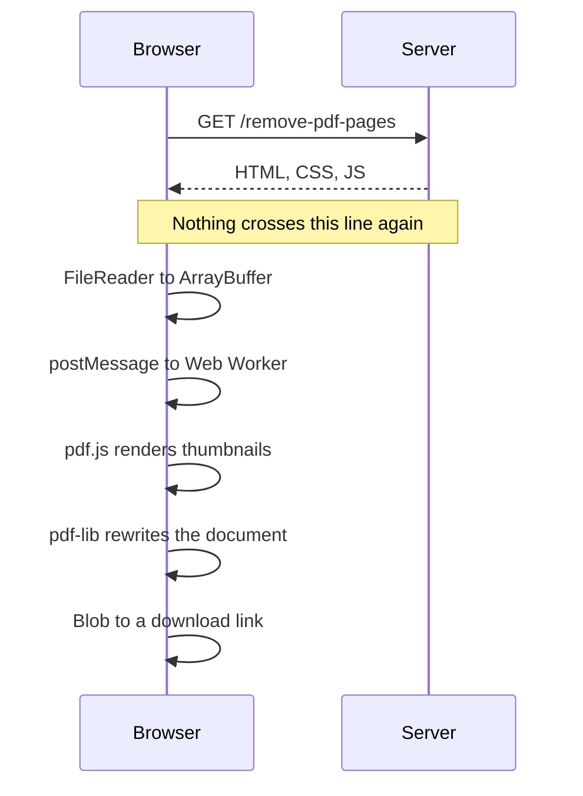

# Architecture

Why RetroPDF is built the way it is. For running it, see the
[README](README.md).

## The one decision everything follows from

**PDF processing happens in the browser. Files are never uploaded.** The
server sends HTML, CSS and JavaScript, and never receives a PDF.

This is not a privacy preference bolted on afterwards. It determines the
stack, the scaling story and the marketing claim:

- **Privacy is provable.** Open DevTools, watch an empty Network tab, or
  disconnect from the internet and keep working. No competitor running
  server side can say this.
- **Load is flat.** Ten thousand merges an hour costs the same as ten,
  because the server only handed out a static page.
- **Security is structural.** A malicious PDF can only attack the tab it was
  opened in, inside the browser sandbox. Server side tools parse untrusted
  files on infrastructure holding other users' data.

The trade: very large files may exceed what a phone can hold in memory. We
fail with a clear message rather than silently uploading.

## Request flow



The server's entire job is choosing which title, heading and initial mode the
page ships with. It has no API for PDF operations, because there is nothing
for it to do.

## Stack

| Layer | Choice | Why |
|---|---|---|
| PDF manipulation | `@cantoo/pdf-lib` | The original `pdf-lib` has had no release since 2021. This fork is maintained and adds encrypted PDF support. Same API. |
| PDF rendering | `pdfjs-dist` | The only way to draw page thumbnails. pdf-lib cannot render. |
| Threading | Web Worker | A 50MB PDF on the main thread freezes the tab. Not slows, freezes. |
| Frontend | Vanilla JS modules | No framework earns its weight here. |
| Server | FastAPI | Serves HTML per route. Deliberately thin. |
| Proxy and TLS | Caddy | Automatic HTTPS, simple config. |
| Hosting | Any small VM | Sufficient, because the server does no work. |

Both PDF libraries are **vendored into the repo**, not loaded from a CDN. A
CDN request is a third party contact, which would undermine both the privacy
claim and the CSP.

pdf.js is the **legacy** build (`pdfjs-dist/legacy/build`), not the default
one. The default build supports only the latest browsers and calls brand new
functions such as `Math.sumPrecise` without checking, so it fails on phones a
year or two behind. Upgrading means copying `pdf.min.mjs` and
`pdf.worker.min.mjs` from `legacy/build` again, not from `build`.

## Browser support

Chrome and Edge 125 or newer (and browsers built on them, such as Opera and
Samsung Internet 27 or newer), Firefox ESR, and Safari 18 or newer on Mac,
iPhone and iPad. That is what the pdf.js legacy build supports, and nothing
else on the site needs more.

`static/js/support.js` checks for the features those browsers share, on the
reader's own device, and only on a browser missing one shows a message
saying to update it. Everyone else never sees it. Without that check an old
browser shows a blank page, since the scripts it cannot run are the ones
that reveal the page.

## Security

The Content Security Policy is the load bearing part:

| Directive | Effect |
|---|---|
| `connect-src 'none'` | No fetch, XHR, WebSocket or beacon. Files cannot leave. |
| `script-src 'self'` | No CDN, no inline script, no eval. |
| `frame-ancestors 'none'` | Nobody can frame the site and watch what you do. |
| `form-action 'none'` | No form can post anywhere. |

`script-src 'self'` also closes off the class of bug behind CVE-2024-4367 in
pdf.js, where a crafted document could run code in the page. pdf.js is
additionally started with `isEvalSupported: false`.

## Performance

In order of impact:

1. **Web Worker for all PDF work.** The main thread handles file selection
   and progress only.
2. **Transfer ArrayBuffers rather than copying.** `postMessage(buf, [buf])`
   transfers ownership. For a 100MB file that is the difference between
   100MB and 200MB of memory.
3. **Process sequentially.** Peak memory tracks the largest single file, not
   the total.
4. **Render thumbnails lazily**, only visible pages, via IntersectionObserver.
5. **Animate only `transform` and `opacity`.** Anything else forces layout.

Worth knowing: merge cost scales with **object count, not file size**. PDFs
store content as a graph of objects with a cross reference table, and merging
renumbers every object and rebuilds the table. A 5MB file with 50,000 small
objects is slower than a 50MB scan.

WebAssembly was considered and rejected: it wins on small inputs but loses on
large ones and uses more memory, which is the opposite of what this workload
needs.

## Interaction rules

These exist because the product must work for people who are not comfortable
with computers. They are requirements, not preferences.

1. **Plain language.** "Choose a PDF", not "Upload".
2. **Big targets.** Primary buttons at least 48px tall.
3. **One primary action on screen at a time.**
4. **Say what will happen.** "Remove 2 pages and download 10" beats "Apply".
5. **Undo instead of confirm.** Confirmation dialogs get dismissed reflexively.
6. **Drag is never the only way.** Every drag has button equivalents.
7. **Nothing hidden.** No hover to reveal, no right click menus.

## Languages

Each language gets its own addresses, because that is what search engines
index. English keeps the plain addresses it already had, so nothing that has
been linked to moves:

```
/merge-pdf          English
/es/merge-pdf       Spanish
/zh/merge-pdf       Chinese
```

Text lives in `app/translations/*.json`, one file per language, and templates
look up keys. A missing key falls back to English, so a half finished
translation is a page with some English in it rather than a broken one.

## The desktop app counter

The site keeps exactly one number: how many people pressed a button asking
for a desktop app. Collecting email addresses would answer the same question
and undercut the promise the site makes, so the button is an ordinary link and
the server counts the request it was already handling.

Only a request carrying `?ask=1` counts, and the address is rewritten
afterwards, so reloading shows the number without adding to it. The browser
remembers you asked, which stops the ordinary repeats. Someone determined can
clear their storage and count again, and the page says so.

## Layout

Each folder has a short README saying what is in it. Start at
[app/README.md](app/README.md).

## Deliberately not built

- **An upload endpoint.** There is nothing for it to do.
- **Accounts.** Nothing to store, so nothing to secure or leak.
- **Analytics.** Ruled out by the CSP, deliberately.
- **A framework.** Revisit only with evidence that one is needed.
