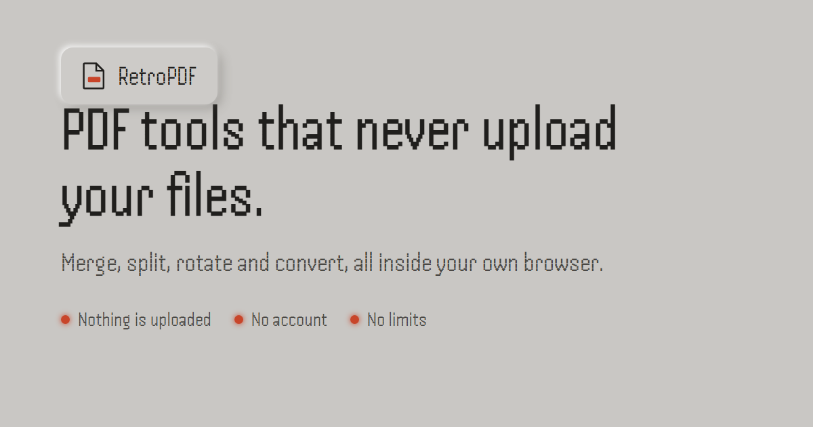

<p align="center">
  
</p>

# RetroPDF

PDF tools that run in your browser. **Files are never uploaded.**

Merge, split, rotate, reorder, delete and extract pages, and convert between
PDF and JPG/PNG. All the work happens on the user's own device. The server
only sends the page, and its security policy (`connect-src 'none'`) makes
the browser refuse any request the page might try to make, so a file cannot
leave even by mistake.

- No uploads, accounts, cookies, ads or analytics
- 11 languages
- Phones, tablets and computers; Chrome, Edge, Firefox, Safari and the rest

## Run it

Needs Python 3.12 and Node 20+.

```bash
python -m venv .venv && source .venv/bin/activate
pip install -r requirements.txt -r requirements-dev.txt
npm ci
uvicorn app.main:app --reload        # http://127.0.0.1:8000
```

## Test it

```bash
python -m pytest tests/              # server, pages, languages
npm test                             # PDF operations and limits
npm run test:e2e                     # every tool in a real browser (server running)
BROWSER=firefox npm run test:e2e     # chromium (default), firefox or webkit
```

Every push runs all of these on GitHub, in Chromium, Firefox and WebKit
(Safari's engine).

## What is where

| Folder | What it holds |
|---|---|
| [app/](app/README.md) | The server: routes, languages, security headers |
| [app/templates/](app/templates/README.md) | The HTML pages |
| [app/static/js/](app/static/js/README.md) | The browser code that does the PDF work |
| [app/translations/](app/translations/README.md) | The words, one file per language |
| [tests/](tests/README.md) | Unit and browser tests |
| [deploy/](deploy/README.md) | Docker, Compose and Caddy |

Further reading: [ARCHITECTURE.md](ARCHITECTURE.md) explains the design and
its trade-offs, and [DEPLOYMENT.md](DEPLOYMENT.md) explains how to put the
site on a server.

## Browser support

Chrome and Edge 125+ (and browsers built on them, such as Opera and Samsung
Internet 27+), Firefox ESR, and Safari 18+ on Mac, iPhone and iPad. An older
browser is told to update instead of being shown tools that do nothing.

## Contributing

Enable the commit hook once after cloning:

```bash
git config core.hooksPath .githooks
```

## Licence

MIT. See [LICENSE](LICENSE).
